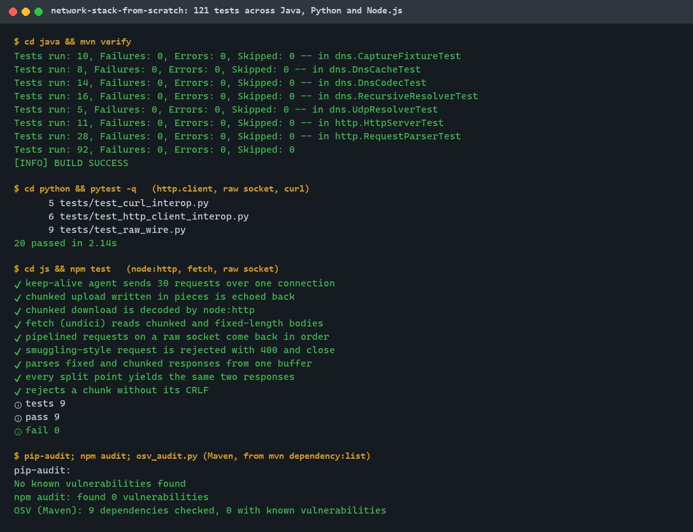
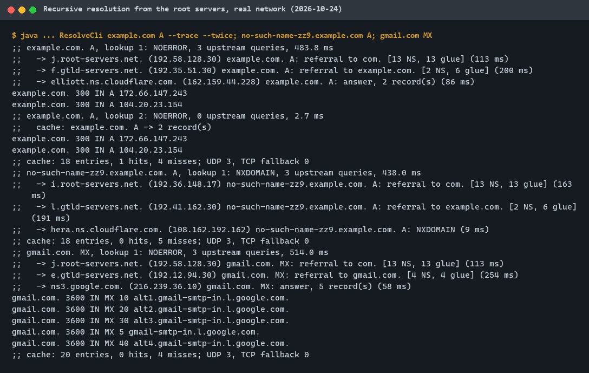
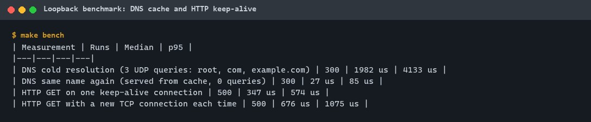
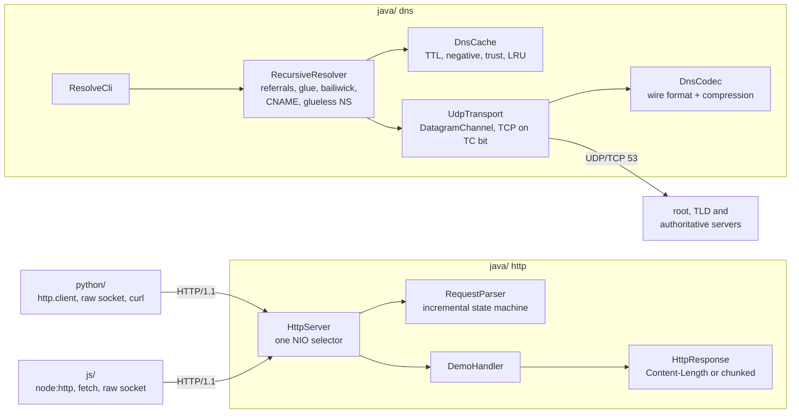
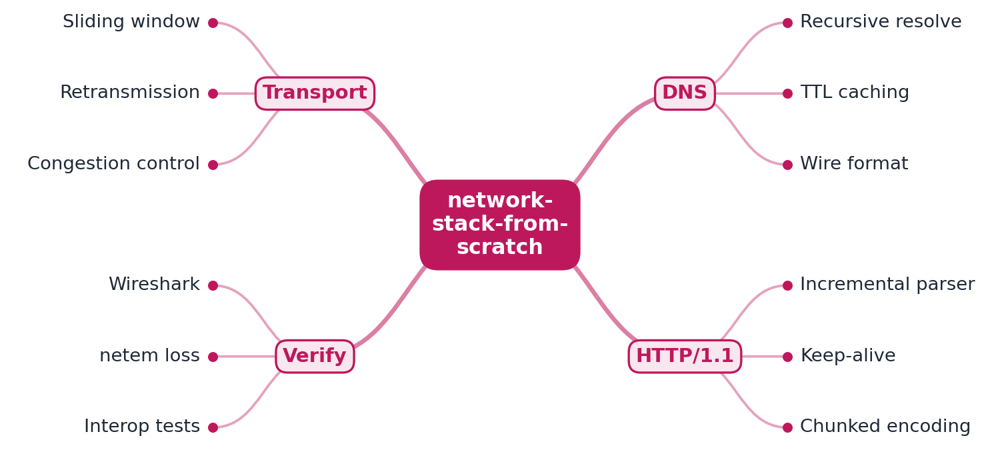

# network-stack-from-scratch

[](https://github.com/EquinoxWN/network-stack-from-scratch/actions/workflows/ci.yml)


> Answers "what actually happens when you type a URL" by building it: a recursive DNS resolver that walks the root, TLD and authoritative servers itself, and an HTTP/1.1 server that frames requests byte by byte. A reliable transport over UDP comes next (M2).

Part of my **CS Foundations** list · Java · Python · JS

## Proof it works

121 tests pass (Java 92, Python 20, Node.js 9), lint and type checks are clean, and the dependency audits find nothing:



The resolver on the real Internet: root -> .com -> authoritative, then the same name again from the cache (0 queries), an NXDOMAIN and an MX lookup:



`make bench` on loopback: the cache turns a 3-query resolution into a lookup, and keep-alive halves HTTP latency:



## Architecture

**What M1 runs today:**



**Full roadmap (M1 to M3):**



## How it works

_Steps 1 and 2 are built and tested (M1); the rest is on the [roadmap](#roadmap)._

1. A recursive DNS resolver queries root, TLD and authoritative servers itself, parses the binary wire format and caches by TTL.
2. An HTTP/1.1 server parses requests incrementally and supports keep-alive and chunked encoding, tested with curl, Python and Node clients.
3. A reliable transport over UDP implements sequence numbers, a sliding window, retransmission and simple congestion control.
4. tc netem injects loss, delay and reordering to prove the transport still delivers correctly.
5. Annotated Wireshark captures in the README show the real packets for each step.
6. Throughput under loss is compared with TCP to show what congestion control buys.

**DNS in detail.** `ResolveCli example.com` asks a root server (RD=0, random id, fresh source port, EDNS0 1232 bytes). The root answers with a referral to `com.` and glue addresses; the resolver asks a `.com` server, gets a referral to `example.com.`, and asks that zone's server, which answers with the A records. Each RRset is cached with its TTL, so the second lookup sends no query, and a lookup of a sibling name starts directly at the cached `example.com.` servers. Only data inside the zone of the server that sent it is believed: glue for other zones, extra answers for other names and referrals that go sideways are ignored. NXDOMAIN and NODATA are cached for the SOA minimum. Truncated replies are retried over TCP.

**HTTP in detail.** The parser takes bytes in any split and returns every request they complete, so pipelined requests come out in order. Bodies are framed by `Content-Length` or chunked encoding (with trailers); anything ambiguous, such as both headers at once, is rejected with 400 and the connection is closed. The server keeps HTTP/1.1 connections open, closes them after 5 s idle, answers `Expect: 100-continue`, sends chunked responses (or a fixed body to HTTP/1.0 clients) and stops reading from a client whose responses are not being read.

## Who it helps

- **Developers debugging DNS:** `make resolve NAME=<name> TYPE=<type>` prints every referral, server and timing, the way `dig +trace` does, from code you can read and step through.
- **Developers working on HTTP servers, proxies or clients:** the parser and its tests show the RFC 9112 framing rules that prevent request smuggling, and the interop suites show how curl, Python and Node clients actually use keep-alive and chunked encoding.
- **Engineers preparing for networking interviews:** each step of "what happens when you type a URL" is a small Java class with tests, real captured packets and measured numbers.
- **Teachers:** the simulated root, TLD and authoritative zones (`Zone`, `DnsServer`) let students try glueless delegations, lame servers and poisoning attempts on loopback, without touching the Internet.

## Tech stack

| Area | In M1 | Planned |
|---|---|---|
| DNS | Recursive resolver, RFC 1035 codec with compression, EDNS0, TCP fallback, TTL and negative cache, simulated zones and servers | DNSSEC validation (not planned for this repo) |
| HTTP | HTTP/1.1 server on Java NIO: incremental parser, keep-alive, pipelining, chunked both ways, limits, lingering close | - |
| Transport | - | Reliable transport over UDP: sequence numbers, sliding window, retransmission, congestion control (M2) |
| Clients | curl, Python `http.client` + raw socket reader, Node `http`/`fetch` + raw socket reader | - |
| Verification | JUnit 6, pytest, node:test, real packet captures as fixtures, loopback benchmark | `tc netem` loss/delay/reordering in CI (M2), Wireshark captures and throughput vs TCP (M3) |

The Java code uses the JDK only (no runtime dependencies). One part per language: [`java/`](java) (Maven, the resolver and server), [`python/`](python) and [`js/`](js) (interoperability clients and tests).

## Run it

**Prerequisites:** JDK 21+ with Maven, Python 3.11+, Node.js 24+, curl. Everything installs inside the repo.

```bash
python -m venv .venv && source .venv/bin/activate   # Windows: .venv\Scripts\activate
make setup        # Python dev tools, npm packages
make lint         # javac -Werror, ruff + mypy --strict, tsc --checkJs --strict
make test         # 121 tests: Java first, then Python and Node against the Java server
make bench        # loopback DNS and HTTP timings
make resolve NAME=example.com TYPE=A   # live resolution from the root servers (outbound port 53)
make serve        # demo server on http://127.0.0.1:8080
```

With the server running: `curl -v http://127.0.0.1:8080/conn http://127.0.0.1:8080/conn` (same connection twice), `curl --raw "http://127.0.0.1:8080/stream?chunks=3&size=5"` (chunk framing), `curl -H "Transfer-Encoding: chunked" --data-binary hello http://127.0.0.1:8080/echo`.

## Tests and results

Full numbers, commands and every test name: [docs/results/m1.md](docs/results/m1.md).

| Check | Result |
|---|---|
| Tests (`make test`) | **121 passed** (Java 92, Python 20, Node.js 9), 0 failed |
| Lint (`make lint`) | clean: javac `-Xlint:all -Werror`, ruff, ruff format, mypy `--strict`, tsc `--checkJs --strict` |
| Audit | pip-audit and npm audit: no known vulnerabilities; Maven: 9 dependencies, 0 known vulnerabilities (OSV) |
| Live DNS (real network) | example.com: 3 queries, 484 ms; again from cache: 0 queries, 2.7 ms |
| DNS cold vs cached (loopback) | median 1,982 us vs 27 us |
| HTTP keep-alive vs new connection (loopback) | median 347 us vs 676 us |
| Improvement found by measuring | UDP receive without a per-query `Selector`: cold resolution median 14.2 ms -> 2.0 ms, p95 142 ms -> 4.1 ms |

| Test file | Tests | What it proves |
|---|---|---|
| `DnsCodecTest` | 14 | RFC 1035 byte layout, compression, all types round-trip, 500 random messages, 20,000 mutated inputs only raise format errors, pointer loops and bad lengths rejected |
| `CaptureFixtureTest` | 10 | 8 real replies from root, .com and authoritative servers decode, re-encode and drive the resolver |
| `DnsCacheTest` | 8 | TTL countdown and expiry, negative caching, trust levels, one-day cap, LRU bound |
| `RecursiveResolverTest` | 16 | Simulated hierarchy: referrals, cache reuse, CNAMEs, glueless delegation, NXDOMAIN/NODATA, lame servers, poisoning and sideways referrals ignored, limits |
| `UdpResolverTest` | 5 | Real UDP/TCP sockets on loopback: TCP fallback on truncation, spoofed id dropped, timeout |
| `RequestParserTest` | 28 | Every split point gives the same requests; chunked with trailers; 20 ambiguous or malformed requests rejected; size limits; response framing |
| `HttpServerTest` | 11 | Pipelining, chunked both ways, 100-continue, idle close and 408, HTTP/1.0, 503 at the limit, JDK HttpClient on one connection |
| `test_http_client_interop.py` | 6 | Python `http.client`: 50 requests on one connection, chunked upload and download |
| `test_raw_wire.py` | 9 | Raw socket: pipelining order, chunk sizes and trailer on the wire, rejections close the connection |
| `test_curl_interop.py` | 5 | curl reuses the connection, chunked upload, exact `--raw` framing, HTTP/1.0 |
| `interop.test.js` | 6 | Node keep-alive agent (29 of 30 on a reused socket), chunked upload/download, fetch, pipelining, smuggling rejected |
| `rawClient.test.js` | 3 | The raw response parser used by the Node tests |

## Roadmap

**M1** (≈8 h)
- [x] Write `docs/rfc/0001-design.md`: problem, goals, non-goals, chosen design
- [x] A recursive DNS resolver queries root, TLD and authoritative servers itself, parses the binary wire format and caches by TTL.
- [x] An HTTP/1.1 server parses requests incrementally and supports keep-alive and chunked encoding, tested with curl, Python and Node clients.

**M2** (≈8 h)
- [ ] A reliable transport over UDP implements sequence numbers, a sliding window, retransmission and simple congestion control.
- [ ] tc netem injects loss, delay and reordering to prove the transport still delivers correctly.

**M3** (≈9 h)
- [ ] Annotated Wireshark captures in the README show the real packets for each step.
- [ ] Throughput under loss is compared with TCP to show what congestion control buys.
- [ ] Publish the proof below with real numbers

## Proof

What this repo must show before it counts as done:

- Throughput-vs-loss chart against TCP, plus annotated packet captures.

| Result | Value |
|---|---|
| M3 proof above | Not measured yet (M3). Current M1 numbers: see [Tests and results](#tests-and-results). |

## Why it matters

- **Interview angle:** "What happens when you type a URL?" answered at packet level, plus networking rounds for infra roles.
- **Upstream I'd like to contribute to:** Netty or dnsjava: tests and bug fixes.

## Design docs

- [RFC 0001: design](docs/rfc/0001-design.md)
- [ADR 0001: record architecture decisions](docs/adr/0001-record-architecture-decisions.md)
- [ADR 0002: reject ambiguous HTTP framing instead of guessing](docs/adr/0002-reject-ambiguous-http-framing.md)
- [ADR 0003: one NIO selector thread for the HTTP server](docs/adr/0003-one-selector-thread-for-http.md)
- [M1 results](docs/results/m1.md)

## Scope

This is a learning and portfolio system, not a hosted production service. Everything runs locally; the demo server binds to 127.0.0.1 by default and the resolver does not validate DNSSEC.

## Security and contributing

- Every GitHub Action is pinned to a commit SHA; workflows run read-only, without persisted credentials.
- Dependabot update pull requests are paused (`open-pull-requests-limit: 0`) so the repository keeps a single `main` branch; dependencies are updated by hand and checked by the CI audit.
- The CI workflow is written to run lint, tests, `make bench`, a live resolution job, `pip-audit`, `npm audit` and OSV-Scanner on a CycloneDX SBOM of the Java dependencies on every push; it is green ([run](https://github.com/EquinoxWN/network-stack-from-scratch/actions/runs/41144850446)), and the live job resolved example.com from the root servers. The numbers in this README come from local runs.
- Inputs are bounded: DNS section counts are checked before allocation, HTTP lines, headers and bodies have size limits, and responses refuse header values containing CR or LF.
- Report vulnerabilities privately: see [SECURITY.md](SECURITY.md). To contribute, see [CONTRIBUTING.md](CONTRIBUTING.md).

## License

MIT, see [LICENSE](LICENSE).
